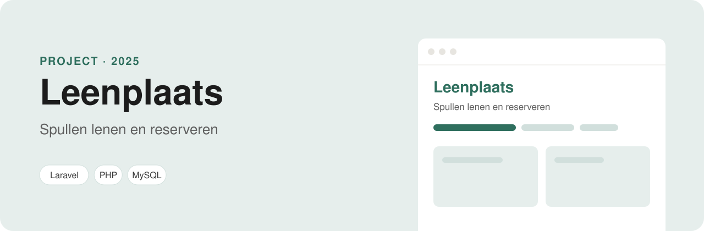

<p align="center">
  
</p>

<p align="center">
  
  
  
  
</p>

# Leenplaats

Leenplaats is een webapp waar mensen spullen aan elkaar kunnen uitlenen. Je zet iets online (een boormachine, een tent, een spelcomputer) en een ander kan het voor een paar dagen reserveren.

Ik bouw het met **Laravel**. In dit project leer ik hoe MVC, migraties en Eloquent-modellen in de praktijk samenwerken.

## Functies

- **Inloggen en registreren**, met testaccounts onder het inlogformulier.
- **Alle spullen bekijken**: prijs per dag, van wie het is, en of het vrij of gereserveerd is.
- **Iets aanbieden**: zet zelf een product online. Je kunt het later tijdelijk uit de verhuur halen.
- **Reserveren** voor een periode. Overlapt die met een andere reservering, dan krijg je een melding; je eigen spullen kun je niet reserveren.
- **Mijn reserveringen**: een overzicht met het aantal dagen en de prijs, en een knop om te annuleren.
- **API**: `GET /api/producten` geeft alle producten als JSON.

## Hoe het in elkaar zit

- **Eloquent-relaties**: een gebruiker heeft producten en reserveringen, een product heeft een eigenaar en reserveringen.
- **Controllers**: `AuthController`, `ProductController` en `ReservationController`, met validatie op elk formulier.
- **Middleware**: pagina's om iets aan te bieden of te reserveren zijn alleen voor ingelogde gebruikers.
- **Blade-layout** met Tailwind CSS (gebouwd naar `public/css/app.css` met `npm run build:css`).

## Zelf draaien

Je hebt PHP 8.1+ en Composer nodig. Een database hoef je niet in te stellen: Leenplaats gebruikt **SQLite**, een bestand in `database/database.sqlite`.

```bash
git clone https://github.com/ParisAngelopoulos/leenplaats.git
cd leenplaats
composer install
cp .env.example .env
php artisan key:generate
php artisan migrate --seed
php artisan serve
```

`migrate --seed` maakt het databasebestand aan en vult het met voorbeelddata. De site draait dan op http://localhost:8000. De testaccounts (`paris@voorbeeld.nl`, `sanne@voorbeeld.nl`, `daan@voorbeeld.nl` en `lisa@voorbeeld.nl`) hebben allemaal het wachtwoord `welkom123`. Wil je opnieuw beginnen, dan zet `php artisan migrate:fresh --seed` alles terug.

## Mappen

| Map | Wat erin staat |
| --- | --- |
| `app/Models` | `Product`, `Reservation` en `User` |
| `app/Http/Controllers` | `ProductController` |
| `database/seeders` | Voorbeelddata voor gebruikers, producten en reserveringen |
| `resources/views/producten.blade.php` | Het productoverzicht |
| `database/migrations` | De tabellen voor producten en reserveringen |
| `routes/web.php` | De routes van de site |

---

Gemaakt door **Paris Angelopoulos**, web developer in opleiding · [GitHub](https://github.com/ParisAngelopoulos) · [parisangelopoulos@gmail.com](mailto:parisangelopoulos@gmail.com)
